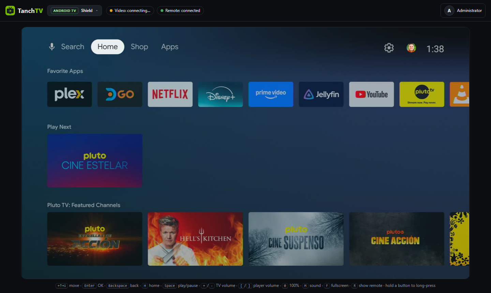
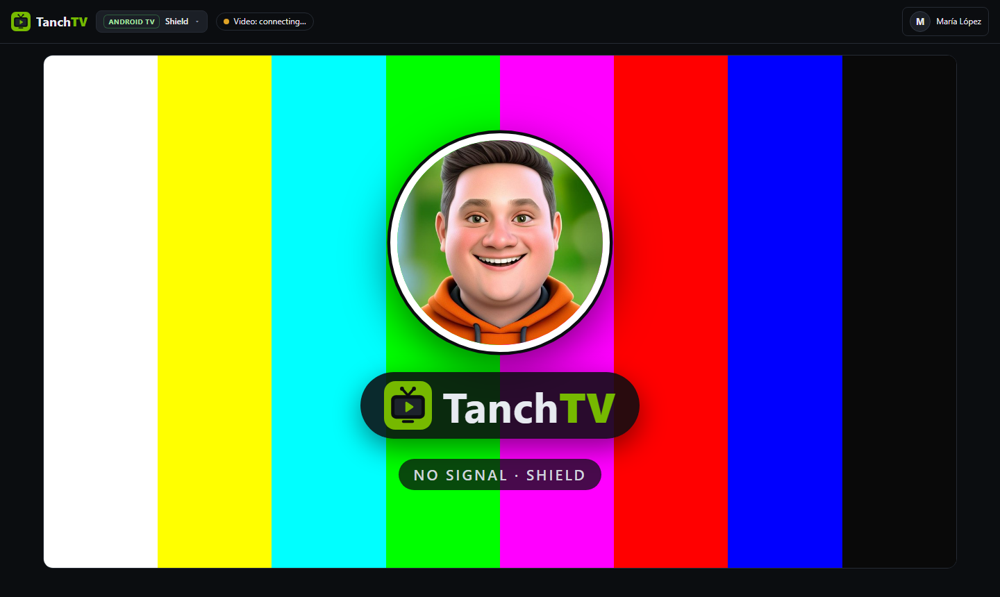
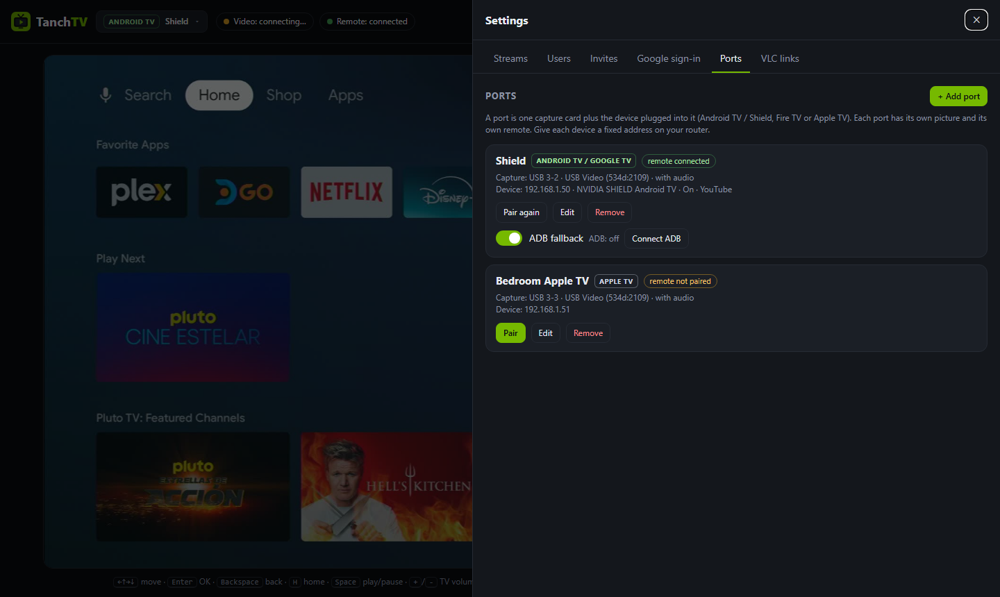
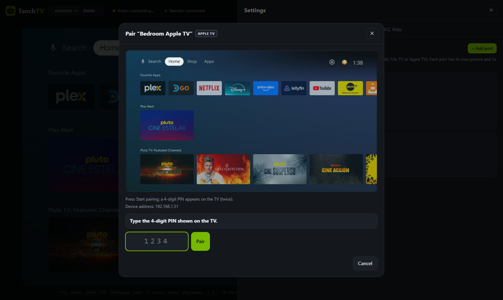

<p align="center">
  
</p>

<h1 align="center">TanchTV</h1>

<p align="center">
  Watch and control your TV boxes from any browser.<br>
  HDMI capture cards + a self-hosted web app: live picture and sound, a real remote for each box,
  sign-in with roles, invites, passkeys and Google.
</p>



TanchTV turns cheap USB HDMI capture cards into "ports". Each port is one capture card plus the box
plugged into it (an **Android TV / Google TV** such as the NVIDIA Shield, a **Fire TV**, or an
**Apple TV**). The web page plays each port's picture with low latency and gives you a remote that
talks to that box over your network.

---

## Install it with an AI agent (quickest)

Clone or download this repository from **<https://github.com/raskitoma/tanchtv>**, then open your
coding agent (Claude Code, Codex, Antigravity, Grok, ...) in the project folder and paste:

```text
Read AGENT_SETUP.md in this repository and follow it to install TanchTV on my server.
Ask me for everything you need before you change anything.
```

[`AGENT_SETUP.md`](AGENT_SETUP.md) walks the agent through the whole installation: it checks the
server, finds your capture cards, asks you for every value it needs (host, domain, Google sign-in,
devices), deploys the containers, and makes sure you secure the first admin with a **passkey**.

Prefer to do it yourself? See [Manual installation](#manual-installation).

---

## Features

**Video**
- One port per capture card, switchable from the header (or press `P`); each port has its own
  picture, sound, remote and app shortcuts.
- WebRTC straight from the server when the browser can reach it (LAN or VPN, well under a second
  of delay); otherwise MSE over the app's own WebSocket, through your reverse proxy.
- HD (1080p) and a lighter 720p "SD" stream for phones and weak links (auto or manual).
- Keeps playing in a background tab, minimized, behind other windows or while screen-shared.
- Player volume up to 200 %, a sound mixer (presets for voices and night, voice clarity,
  leveling, bass, treble), fullscreen (including iPhone), keyboard shortcuts.
- **No-signal test card**: when a box is off or asleep, viewers see colour bars with the
  owner's photo and the TanchTV logo instead of a black or frozen picture.



**Remote control** (per port, after a one-time pairing)
- **Android TV / Google TV**: Android TV Remote protocol v2, with optional ADB fallback.
- **Fire TV**: ADB over the network.
- **Apple TV**: pyatv (AirPlay + Companion).
- D-pad, back, home, menu, media keys, volume, power / sleep / wake, text input, app shortcuts
  (YouTube, Netflix, Plex, Disney+, Prime Video, Twitch). Buttons a box can't do are greyed out.
- **Swipe gestures** on the picture (turn on with 👆 or `G`): swipe = arrows, swipe and hold =
  keep moving, double-tap = OK, hold = Back.
- **Phone remote mode** (`/remote`, or pick "Use as a remote" the first time a phone opens
  TanchTV): a touchpad plus big buttons, no video (saves data), screen kept on, optional small
  live picture. It **follows the TV you're watching on another device** (switch ports on the PC
  and the phone switches too), or you pick one yourself.

**Accounts and admin**
- Own sign-in page: **Continue with Google**, **Sign in with a passkey**, and a small
  *Admin login* link for the built-in `admin`.
- Roles: **admin** (everything) and **viewer** (watch only; admins can grant remote control).
- Invites: single-use, expiring links, optionally tied to one Google account. Nobody can sign up
  without an invite.
- **Streams** panel: who is watching what, from where, over which path; stop or sign people out.
  Streams paused or abandoned for 120 s stop by themselves.
- **VLC links**: private `…/vlc/<token>/stream.ts` URLs (MPEG-TS, H.264 + AAC) for VLC, OBS or a
  Stream Deck button, in their own **VLC links** section (user menu): every user manages their own,
  admins see all. Copy a link again any time; revocable, optional expiry. One link can show any TV:
  change what it shows, or set it to *Follow me* (the TV you last switched to); open players switch
  over in seconds.
- **Ports** settings: pick a capture card, the box type and its address, pair with a live picture
  of the TV in a pop-up so you can read the code.

| Ports | Pairing |
|---|---|
|  |  |

---

## How it works

```
 TV box ──HDMI──▶ USB capture card ──▶ tanchtv-stream (go2rtc + ffmpeg, GPU H.264) ──WebRTC :8555──▶ browser
                                              ▲   │ RTSP/WS (loopback only)
                                              │   ▼
 TV box ◀──── LAN: ATV remote / ADB / pyatv ── tanchtv-app (aiohttp, :8095) ◀──https── reverse proxy ◀── browser
```

| Container | What it does |
|---|---|
| `tanchtv-stream` | [go2rtc](https://github.com/AlexxIT/go2rtc) 1.9.15. Runs [`go2rtc/capture.sh`](go2rtc/capture.sh) once per port: finds the card by its **USB port path**, reads MJPEG 1080p30 + the card's own audio, encodes H.264 (VAAPI, or CPU) + Opus + AAC. Streams `p<id>` (HD) and `p<id>_sd` (720p) are always running, so viewers never wait. API and RTSP listen on loopback only. |
| `tanchtv-app` | Python 3.12 / aiohttp. Web UI, sign-in (sessions, passkeys via py_webauthn, Google OAuth), roles, invites, one remote driver per port, the video WebSocket proxy, VLC links, and the no-signal detector. Writes go2rtc's config through its API whenever ports change. SQLite in `./data`. |

Both containers use host networking so WebRTC can offer the server's real LAN/VPN addresses.

Capture cards are identified by the USB socket they're plugged into (for example `3-2`), because
identical dongles report the same vendor, product and serial. Keep each card in its socket, or
edit the port after moving it.

---

## Requirements

- A Linux host with Docker and Docker Compose v2 (tested on TrueNAS SCALE).
- One USB HDMI capture card per box. MacroSilicon MS2109 dongles (`534d:2109`, the cheap
  "USB Video" ones) are what this was built and tuned for; other UVC cards work if they offer the
  format you set in `.env`.
- Recommended: an Intel or AMD GPU for VAAPI H.264 encoding (an Intel Arc A380 handles several
  ports easily). Without one set `HWACCEL=none` (CPU encoding, roughly one core per port).
- An **https** reverse proxy (Nginx Proxy Manager, Caddy, Traefik...) with WebSockets enabled.
  Passkeys and Google sign-in only work over https on a real host name.
- The boxes on the same network as the server, ideally with fixed addresses (DHCP reservations).

---

## Manual installation

```sh
git clone https://github.com/raskitoma/tanchtv.git && cd tanchtv
cp .env.example .env                                  # then edit it (see the comments inside)
cp go2rtc/go2rtc.example.yaml go2rtc/go2rtc.yaml
docker compose up -d --build
docker logs tanchtv-app                               # shows a generated admin password if TVR_PASSWORD was empty
```

1. **Reverse proxy**: point `https://tv.example.com` to `http://<server>:8095` with WebSocket
   support. Caddy example: `tv.example.com { reverse_proxy 192.168.1.10:8095 }`.
2. **Firewall**: allow **8555/tcp and 8555/udp** from your LAN (and VPN) to the server for WebRTC.
   Without it everything still works, through the proxy, with about a second more delay.
3. **First sign-in**: open `https://tv.example.com/login?admin`, sign in as `admin` with the
   password from `.env` (or the logs).
4. **Add a passkey right away**: *My account* (top right) → *Passkeys* → *Add passkey*. From then
   on you sign in with one tap, and the password stays as a backup that only the CLI can change.
5. **Ports**: *Settings → Ports → + Add port*. Pick the capture card, the box type, type the box's
   IP, save, then **Pair** (see below).
6. **Google sign-in** (optional, needed for invites): *Settings → Google sign-in*. See
   [Google sign-in](#google-sign-in).

### Pairing each box

| Box | On the box first | In TanchTV |
|---|---|---|
| Android TV / Google TV | nothing | **Pair**, then type the 6-character code shown on the TV. |
| Android TV ADB fallback (optional) | *Developer options → Network debugging* on | Turn on *ADB fallback* in the port, **Connect ADB**, accept "Allow debugging". |
| Fire TV | *Settings → My Fire TV → Developer options → ADB debugging* on (no Developer options? *About* → click the device name 7 times) | **Connect**, then "Allow" on the TV with "Always allow" ticked. |
| Apple TV | *Settings → AirPlay and HomeKit → Allow access*: "Everyone on the same network" | **Pair**, type the AirPlay code, then the second (Companion) code. |

The pairing window shows the port's live picture so you can read the codes remotely. If a box is
updated or reset and stops accepting the pairing, the port says so; just pair again.

### Google sign-in

1. In [Google Cloud Console](https://console.cloud.google.com/): *APIs & Services → OAuth consent
   screen*: External, app name "TanchTV", your email. Publish it (or add each user as a test user).
2. *Credentials → Create credentials → OAuth client ID → Web application*.
   *Authorized redirect URI*: `https://tv.example.com/auth/google/callback`
   (TanchTV shows the exact value in *Settings → Google sign-in*).
3. Paste the **Client ID** and **Client secret** into *Settings → Google sign-in*, set the
   **Public URL** (`https://tv.example.com`), turn it on and save.
4. *Settings → Invites*: create an invite link for each person. They sign in with Google through it.

The client secret is stored only in the app's database (`./data`), never in files you commit.

---

## Configuration

All settings live in `.env` (copy [`.env.example`](.env.example)); everything else is done in the
web UI and stored in `./data`.

| Variable | Default | Meaning |
|---|---|---|
| `TVR_PASSWORD` | random | Password for the built-in `admin`, used only on the very first start. |
| `PORT` | `8095` | HTTP port of the app. |
| `IDLE_KILL_SECONDS` | `120` | Stop a stream after this long paused or not reporting. |
| `WEBRTC_INTERFACES` | all | Interfaces WebRTC offers to browsers, e.g. `eth0,tailscale0`. |
| `HWACCEL` | `vaapi` | `vaapi` (Intel/AMD GPU) or `none` (CPU). |
| `VAAPI_DEVICE` | `/dev/dri/renderD128` | GPU render node. |
| `LIBVA_DRIVER_NAME` | `iHD` | `iHD` (modern Intel), `i965` (old Intel), `radeonsi` (AMD). |
| `CAPTURE_FORMAT` / `CAPTURE_SIZE` / `CAPTURE_FPS` | `mjpeg` / `1920x1080` / `30` | What to ask the capture card for. |
| `VIDEO_BITRATE` | `5M` | HD stream bitrate. |

**Your own no-signal photo**: replace `app/static/slate-photo.jpg` (square, about 480×480) and
rebuild (`docker compose up -d --build tanchtv-app`).

---

## Operations

```sh
docker compose up -d --build                 # deploy / update (after git pull)
docker compose logs -f tanchtv-app           # app logs
docker compose restart tanchtv-stream        # restart capture/encoding

# built-in admin (only from the server)
docker exec -it tanchtv-app python cli.py admin password            # set a new password
docker exec -it tanchtv-app python cli.py admin password --random   # generate one
docker exec -it tanchtv-app python cli.py admin disable | enable
docker exec -it tanchtv-app python cli.py users
docker exec -it tanchtv-app python cli.py logout-all
```

**Back up `./data`**: it holds the database (users, sessions, settings, Google secret, ports) and
every pairing key. It is git-ignored on purpose.

---

## Limits worth knowing

- **HDCP**: the box → capture card link has no HDCP. Home screens and many apps work; DRM apps
  (Netflix, Disney+, Prime Video) may show black or refuse to play.
- **No CEC**: MS2109 cards don't wire the HDMI CEC line, so control goes over the network.
- **MS2109**: 1080p only as MJPEG, 30 fps at most. Two cards on the same USB 2.0 controller share
  its bandwidth; use different controllers if the picture stutters.
- **Passkeys** are bound to the host name they were created on and need https.

---

## Working on the code

Read [`AGENTS.md`](AGENTS.md): layout, how each part works, conventions, how to check and deploy
changes, and the hardware quirks learned the hard way. It's written for people and coding agents
alike.

## License

[MIT](LICENSE)
